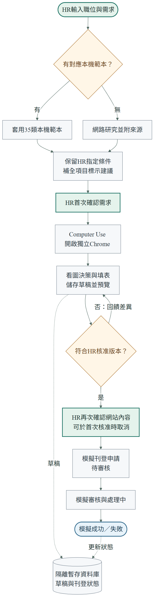

# 招募建議與模擬刊登流程

這份圖供HR、展示者與PR審查者確認目前功能。由上往下閱讀：輸入需求、產生建議、HR核准、看圖填表、核對資料，再完成模擬刊登。

可放大版本：[SVG](recruitment-workflow.svg)。可修改原始檔：[Mermaid](recruitment-workflow.mmd)。

## 流程說明

1. HR輸入職位、地區與簡短條件，例如「測試員；招募三人，月薪面議」。公司資料可稍後確認。
2. 有收錄的職稱直接套用35類本機範本及別名；未收錄的職稱進入網路研究，必須提供可追溯來源。
3. 系統保留HR明示的人數、薪資等條件；自行補全的工時、技能與工作內容標成建議。
4. HR修改並第一次核准內容。核准後，Computer Use在獨立Chrome中讀取截圖，決定滑鼠、鍵盤及捲動動作。
5. Agent操作一般模擬求才網站，填表、儲存草稿與預覽。後端核對實際已存資料；若不一致，將差異交回模型修正。
6. 預設等待HR第二次確認網站內容。HR也可在第一次核准時取消此步，核對完成後直接繼續。
7. 透過一般網站送出模擬申請，經待審核、處理中，到成功或失敗。控制台顯示進度，網站列表呈現隔離資料庫內的狀態。

## 例外與界線

| 情況 | 目前處理方式 |
|---|---|
| 搜尋失敗或缺少來源 | 顯示錯誤，不冒充已取得網路資料 |
| 範本請求未回應 | 最多等待15秒，恢復按鈕供重試 |
| 網路研究未回應 | 前端最多等待60秒，顯示逾時；後端連線／讀取上限5／45秒 |
| 填表資料與核准版本不同 | 回饋差異並修正；送出時再次核對，禁止不一致的刊登 |
| 停止操作 | 工作標示停止；下一個滑鼠鍵盤動作前檢查停止狀態 |
| 操作過久 | 最多30次畫面決策，等待HR確認最多10分鐘 |
| 儲存位置 | 隔離暫存SQLite，展示資料約保留20分鐘；不使用正式企業資料庫 |
| 正式平台 | 不刊登至104／1111，不發招募訊息，不接受真實履歷 |

職位研究及看圖操作會使用外部模型服務。圖中的刊登流程只對本機模擬網站執行。示範入口預設成功情境，模擬網站另提供失敗及重試流程。

## 圖例與驗證

圓角表示起點或結果，矩形表示動作，菱形表示判斷，圓柱表示資料庫。實線表示流程；虛線表示資料儲存。顏色僅輔助辨識。

來源以目前程式為準：`recruitment/job_research.py`、`api/recruitment_agent.py`、`recruitment/computer_use.py`及`api/mock104.py`。此圖未包含正式平台串接或未實作的人才邀請流程。

產圖：Mermaid CLI 11.16.0。檢查者：Codex。檢查日期：2026-11-03。圖檔以白底輸出，附文字版流程，避免依賴瀏覽器主題或即時Mermaid載入。
